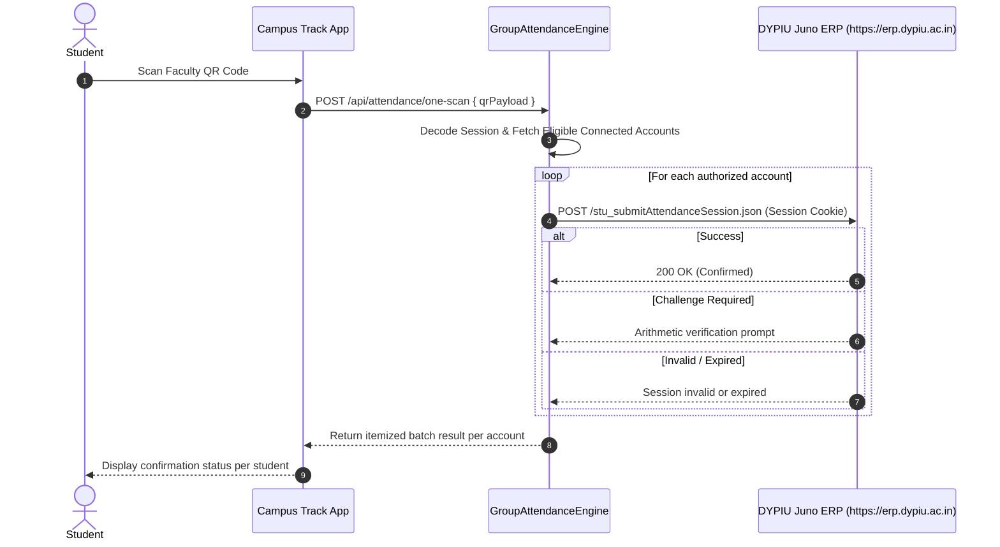

# Campus Track — Integration Guide: DYPIU Juno ERP

---

## 1. ERP Authentication Flow

Campus Track interacts with DYPIU's Juno ERP portal (`https://erp.dypiu.ac.in`) using Spring Security form authentication:

1. **Initial Cookie Retrieval**:
   - `GET https://erp.dypiu.ac.in/login.htm`
   - Yields `JSESSIONID` and `__Host-JUNO_DEVICE`.
2. **Security Check Submission**:
   - `POST https://erp.dypiu.ac.in/j_spring_security_check`
   - Content-Type: `application/x-www-form-urlencoded`
   - Parameters: `j_username=<PRN/Email>`, `j_password=<Password>`
   - Redirection check:
     - If `Location: /login.htm?failure=true` → Authentication failed.
     - If `Location: /home.htm` → Authentication succeeded.
3. **Session Activation & Priming**:
   - `GET https://erp.dypiu.ac.in/home.htm`
   - `GET https://erp.dypiu.ac.in/stu_myDashBoard.htm`
4. **Session Verification**:
   - `GET https://erp.dypiu.ac.in/stu_getStudentIdFromSession.json`

---

## 2. One-Scan Attendance Flow

